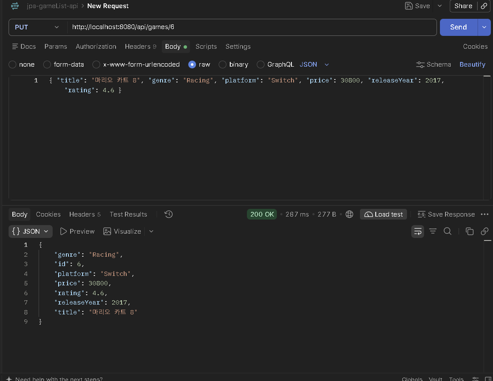

# Game List JPA Project

## 1. 프로젝트 소개

- 주제: 9주차 코드 수정, Spring Boot + JPA로 만든 게임 목록 관리 REST API
- 주요 기능: 게임 CRUD, 조건 검색 및 정렬, 생성·수정 시간 자동 기록
- GitHub: https://github.com/2026-2-WebService/assign10-c01-22500091.git
- Render: https://jpa-game-list-project.onrender.com

## 2. 주요 구현 내용 및 결과

### Query Method
- `findByGenre`: 장르로 검색
    - `GET /api/games/search/genre?genre=RPG`
- `findByGenreAndPlatform`: 장르와 플랫폼으로 검색
    - `GET /api/games/search/genre-platform?genre=RPG&platform=PC`
- `findByPlatformOrderByRatingDesc`: 플랫폼으로 검색 후 평점 높은 순 정렬
    - `GET /api/games/search/platform-rating?platform=PC`

(실행 결과 캡처)
Genre=RPG 검색

장르와 플랫폼으로 검색

플랫폼 검색 후 정렬

### Dirty Checking
- `@Transactional`을 적용하고 `save()` 없이 Entity 값만 변경해서 수정
- Postman으로 수정한 뒤 DBeaver에서 값이 바뀐 것을 확인

(실행 결과 캡처)
수정 Postman

Dbeaver 적용 확인

### Auditing
- 등록하면 `created_at`과 `updated_at`이 자동으로 기록된다.
- 수정하면 `updated_at`만 바뀐다.

(실행 결과 캡처)

## 3. Weekly Review

### Key Learning
- 메서드 이름만으로 검색 쿼리를 만들 수 있는 Query Method
- `save()` 없이 수정되는 Dirty Checking
- 날짜를 자동으로 기록하는 Auditing

### Problem & Solution
- 지난주 repo에 push하자 Render 배포가 덮어씌워질 뻔했다. 같은 repository에 수정하려 해서 9주차 과제 코드가 덮여씌워질뻔 했다. 새 repo를 만들어 따로 배포했다.

### Reflection
SQL을 직접 쓰지 않아도 검색과 수정이 된다는 점이 신기했다. 코드뿐만 아니라 실행 환경 설정도 중요하다는 것을 다시 한번 느꼈다.

## 4. AI Usage

- 사용 도구: Claude
- 주요 질문: 실행 에러 원인, Render 배포 설정 질문
- 직접 검증한 부분: Query Method, Dirty Checking, Auditing 적용 위치 파악 및 코드 작성, Postman과 DBeaver로 검색, 수정, 날짜 기록 결과를 직접 확인했다.
- AI 사용 비율: 약 15%