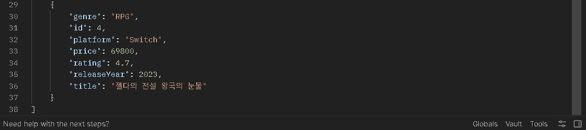
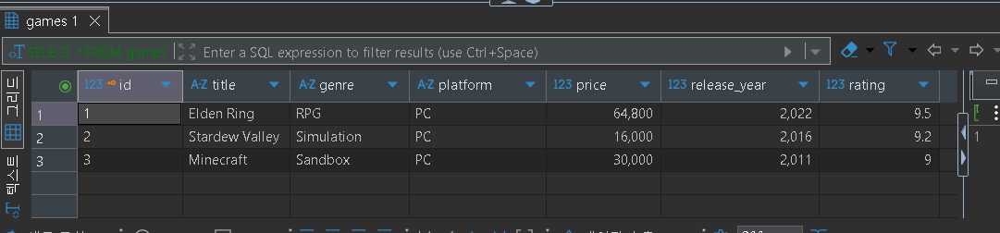
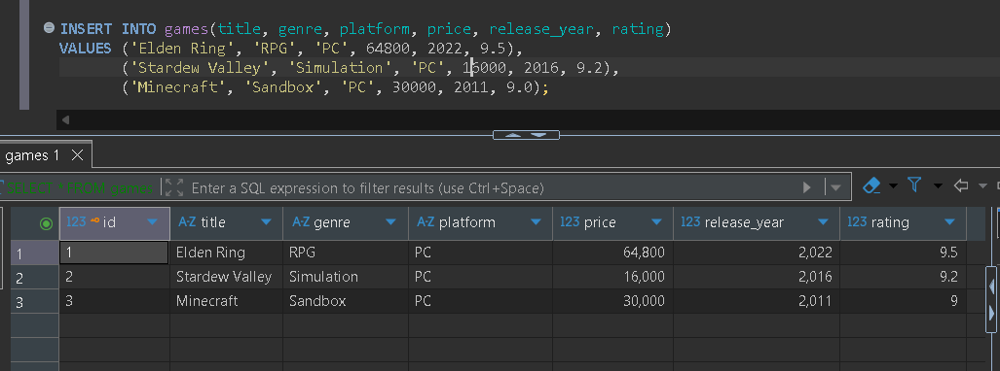
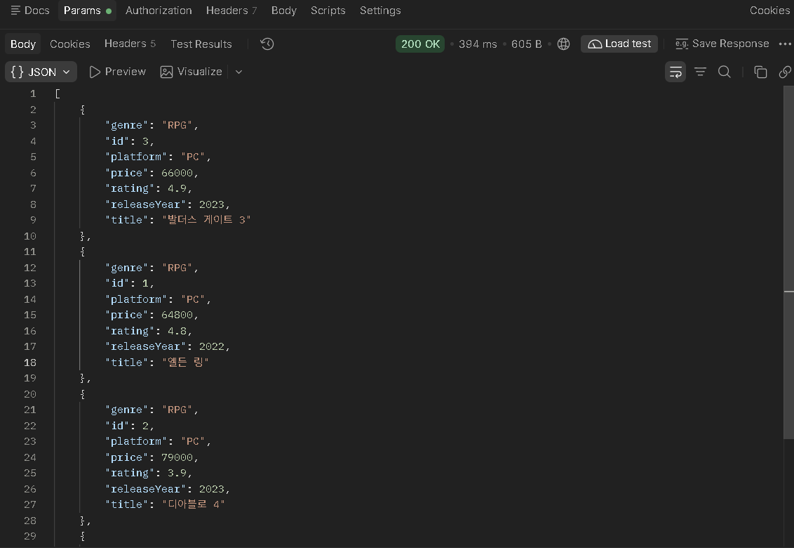
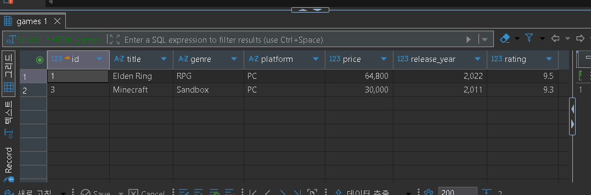
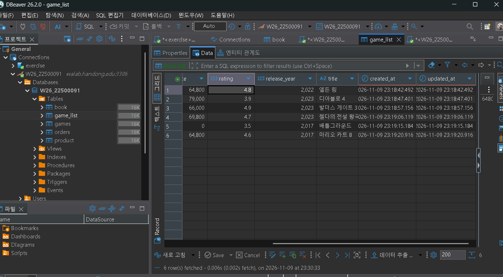
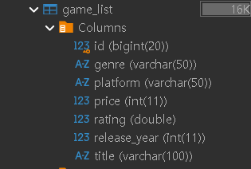
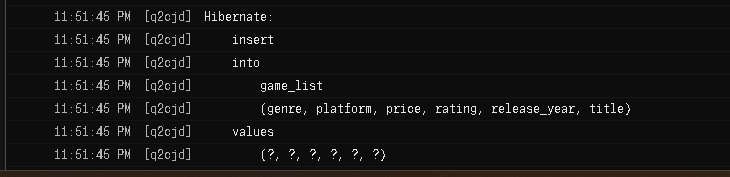

# (프로젝트 제목)

- GitHub Repository: https://github.com/2026-2-WebService/assign09-c01-22500091.git
- Render Deployment: https://jpa-gamecrud.onrender.com

---

## ① 프로젝트 소개

### 주제 및 주요 기능
> game기록 관리를 하는 주제를 정하였고, 등록, 조회, 수정, 삭제 기능을 구현하였다.

### Entity 필드 구조
> id, title, genre, platform, price, releaseYear, rating

| 필드          | 타입      |
|-------------|---------|
| id          | Long    |
| title       | String  |
| genre       | String  |
| platform    | String  |
| price       | integer |
| releaseYear | Integer |
| rating      | Double  |

### 프로젝트 구조 및 개발환경
> 패키지 구조:entity, repository, dto, service, controller / JDK17 / Spring Boot 4.1.2 / Dbeaver 사용

** IntelliJ 프로젝트 폴더 구조**


---

## ② Database SQL Practice

### 기존 Table 조회 및 데이터 추가
> games 테이블에 위에 작성한 entity필드 구조대로 데이터를 집어넣었다.




### 새 Table 생성

CREATE TABLE games (
id BIGINT AUTO_INCREMENT PRIMARY KEY,
title VARCHAR(100) NOT NULL,
genre VARCHAR(50),
platform VARCHAR(50),
price INT,
release_year INT,
rating DOUBLE
);


### INSERT
INSERT INTO games(title, genre, platform, price, release_year, rating)
VALUES ('Elden Ring', 'RPG', 'PC', 64800, 2022, 9.5),
('Stardew Valley', 'Simulation', 'PC', 16000, 2016, 9.2),
('Minecraft', 'Sandbox', 'PC', 30000, 2011, 9.0);



### UPDATE
> UPDATE games SET rating = 9.3 WHERE title = 'Minecraft'; --> rating 값을 9.3으로 변경함



### DELETE
> DELETE FROM games WHERE title = 'Stardew Valley'; --> 이름이 Stardew Valley인 데이터 삭제



### SELECT
> SELECT * FROM games;
SELECT title, price FROM games;
SELECT * FROM games WHERE genre = 'RPG';

**[캡처] SELECT 3번째 결과**


---

## ③ Spring Data JPA 구현

### Entity 및 JpaRepository 설명
* **`Game` Entity**: DB의 `game_list` 테이블과 1:1로 매핑되는 자바 객체.
* **`GameRepository`**: `JpaRepository<Game, Long>`를 상속받아 별도 SQL 작성 없이 기본적인 CRUD 메서드를 자동 제공받음.

### 사용한 Annotation의 역할

| Annotation | 역할 |
|---|---|
| `@Entity` | JPA가 관리하는 테이블 매핑 클래스임을 명시 |
| `@Table` | 매핑할 DB 테이블 이름(`game_list`) 지정 |
| `@Id` | Primary Key(기본키) 지정 |
| `@GeneratedValue` | 기본키 자동 생성 전략 설정 (`IDENTITY` = MariaDB `AUTO_INCREMENT`) |
| `@Column` | 컬럼 제약조건(NULL 여부, 길이 등) 및 DB 컬럼명 매핑 |

### REST API Endpoint 목록

| Method | URL | 기능 |
|---|---|---|
| `POST` | `/api/games` | 게임 등록 |
| `GET` | `/api/games` | 게임 전체 조회 |
| `GET` | `/api/games/{id}` | 게임 단건 조회 |
| `PUT` | `/api/games/{id}` | 게임 정보 수정 |
| `DELETE` | `/api/games/{id}` | 게임 삭제 |

### 요청·응답 JSON

* **`POST /api/games` (등록 요청 JSON)**
```json
{
  "title": "Cyberpunk 2077",
  "genre": "RPG",
  "platform": "PC",
  "price": 66000,
  "releaseYear": 2020,
  "rating": 8.8
}
```
### JPA Entity와 MariaDB Table 비교
> 자바 필드의 CamelCase가 DB의 SnakeCase로 자동 전환됨.

📷 **[캡처] DBeaver game_list 테이블 구조**


---

## ④ JPA와 SQL 비교

### save(), findAll(), findById(), deleteById() 사용 결과
> save(): POST 요청 시 INSERT, PUT 요청 시 영속성 컨텍스트를 통한 UPDATE 실행.

findAll(): GET 전체 조회 요청 시 SELECT * 실행.

findById(): GET /{id} 요청 시 단건 SELECT 실행 (존재하지 않으면 예외 처리).

deleteById(): DELETE /{id} 요청 시 해당 레코드 DELETE 실행.


##HIBERNATE SQL문 


### SQL 직접 작성 vs JPA 방식의 차이
> SQL 직접 작성: 반복적인 CRUD SQL과 매핑 코드를 작성해야 해서 생산성이 떨어짐.

JPA 방식: 엔티티 작성 후 메서드 호출만으로 Hibernate가 SQL을 자동 생성해 주어 비즈니스 로직에만 집중 가능.

---

## ⑤ 배포 및 환경 설정

### 환경변수 설정 (변수명만)
> IntelliJ (Run/Debug Configurations): DB_URL, DB_USERNAME, DB_PASSWORD

Render (Environment Variables): DB_URL, DB_USERNAME, DB_PASSWORD

### Render 배포 과정
> Root 경로에 Dockerfile 작성

GitHub 메인 브랜치에 Commit 및 Push

Render에서 Web Service 생성 후 Docker 라이프사이클 지정 및 환경변수 3개 입력하여 배포


### 발생한 문제와 해결 방법
> 문제: DBeaver 접속 시 Connection timed out 발생.

원인: 기본 포트 3306을 썼으나 실제 접속 포트 번호가 달랐음.

해결: 사이트에서 제공된 포트 번호 확인 후 DBeaver 접속 정보 및 DB_URL 수정하여 해결.
---

## ⑥ Weekly Report

### Key Learning
> 
1.환경변수 활용: ${DB_URL} 등을 사용해 보안 정보를 하드코딩하지 않고 관리하는 법 습득.

2. JPA 매핑: @Entity, @Id, @Column 등의 어노테이션이 실제 DB 테이블로 변환되는 흐름 이해.

3. Render 배포: Dockerfile을 이용해 local 환경 그대로 클라우드에 배포하는 체계 경험.

### Problem & Solution
> 문제: Render 배포 후 첫 API 요청 시 응답 지연 발생.

해결: Render Free Tier의 수면 모드(Sleep state)로 인한 Cold Start 현상임을 확인하고 정상 작동 검증함.

### Code Review
> 
'''
@Transactional
public GameResponseDto updateGame(Long id, GameRequestDto requestDto) {
    Game game = gameRepository.findById(id)
            .orElseThrow(() -> new IllegalArgumentException("해당 게임이 존재하지 않습니다. id=" + id));

    game.update(requestDto.getTitle(), requestDto.getGenre(), requestDto.getPlatform(),
                requestDto.getPrice(), requestDto.getReleaseYear(), requestDto.getRating());

    return new GameResponseDto(game);
}
'''
설명:JPA Dirty Checking(변경 감지) 활용. 엔티티를 조회한 뒤 값만 변경하면 
트랜잭션 종료 시점에 Hibernate가 UPDATE 쿼리를 자동 실행함.

### AI Usage
> AI 활용 내용: DBeaver 오류 원인 분석 가이드 작성 참고, Dockerfile 및 README 작성 템플릿 참고.

직접 수정·검증: Game 엔티티 및 DTO 구현, 환경변수 등록, Postman CRUD 테스트 및 DB 확인 직접 실행.

AI 사용률: 30% (문서 구조 템플릿 및 오류 가이드 참고 용도로 사용, 실제 코딩·배포는 직접 수행함)

### Reflection
> 이렇게 배우니까 정말 얻는게 많은거 같다. 이정도 분량에 과제가 딱 좋은듯 하다. 근데 프로젝트형 말고, 부분부분 먼저 적응할수 있도록하는 과제도 있었으면 하는 바람이 약가 있다.
